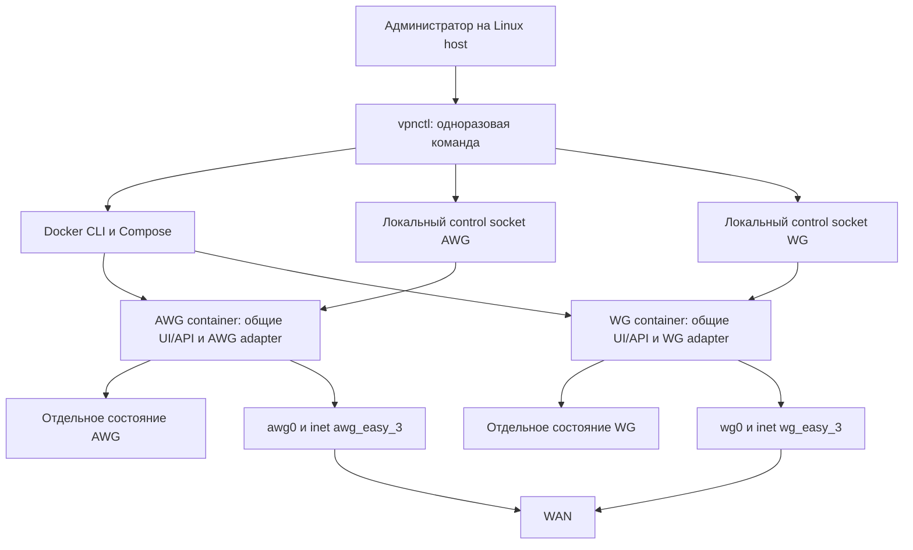

# Архитектура VPN Easy Dual

Статус: этапы 0–5 реализованы; миграция оригинального 0.1.6 и recovery после SIGKILL проверены. Расширенная E2E-матрица и CI добавляются на этапе 7. Reboot отдельной VM и полевая проверка клиентов остаются вне выполненных проверок; см. TEST_REPORT.
Основание: `TZ_VPN_Easy_Dual_Agent.md`, исходный SHA указан в BASELINE_AUDIT.

## Компоненты и потоки

Оба контейнера используют host networking. Панели слушают только внутренние
адреса своего VPN. Третьего постоянного контейнера нет. Manager не монтирует
Docker socket в приложение. Для управления клиентами manager вызывает
одноразовый `docker exec -i` с JSON через stdin; приложение передаёт команду
существующему ClientManager по локальному Unix socket 0600 в runtime 0700.
Это сохраняет общую очередь Web/API и host CLI; отдельный процесс не пишет
состояние параллельно работающей панели. Секреты не передаются в argv.

## Минимальный рефакторинг

1. `InstanceConfig`: валидированные ресурсы экземпляра. Параметризовать
   NftablesPolicy/RuntimeApplier без изменения legacy AWG defaults.
2. `VpnBackend`: адаптеры AmneziaWG и WireGuard; общие операции ключей,
   render, apply, status и health. `AwgArtifacts` становится совместимым
   фасадом общего builder; существующие AWG exports должны совпадать.
3. Bootstrap/StateStore/Application/ClientDiagnostics получают выбранный
   backend. AWG v1/v2 сохраняются; состояние WG имеет явный дискриминатор
   и схему, которую старое AWG-приложение отвергает. При несовпадении backend
   образа и состояния старт прекращается до изменения сети.
4. ApiService/общий UI получают capabilities; WG использует native conf и
   QR того же содержимого. AWG сохраняет vpn://. Все пять языков сохраняются.
5. Общий firewall получает режим Dual и явно проверяет собственный ingress,
   разрешённый egress, host-local/чужую VPN/приватные сети/hairpin/IPv6.
6. `vpnctl` на Python 3 standard library: JSON, tar, SHA-256, subprocess без
   shell-интерполяции, глобальный flock, журнал транзакций. Python 3 — явная
   дополнительная host dependency, проверяемая до установки.

## Реестр владения ресурсами

| Ресурс | AWG | WG |
| --- | --- | --- |
| Compose service | awg-easy | wg-easy |
| Container | awg-easy-3 | wg-easy-dual |
| Backend binaries | awg, awg-quick, amneziawg-go | wg, wg-quick, wireguard-go |
| Интерфейс | awg0 либо сохранённый | wg0 либо явно выбранный |
| IPv4 | существующая 10.8.0.0/24 | отдельная 10.9.0.0/24 |
| IPv6 | существующая ULA/routed | независимая проверенная ULA /64 |
| UDP | сохранённый; fresh случайный | отдельный, по умолчанию 51824 |
| Панель | сохранённая, обычно 51821 | 51825 на собственном VPN IP |
| State | существующий data/ | data-wg/ |
| Runtime | /run/awg-easy-3 | /run/wg-easy-dual |
| Nft table | inet awg_easy_3 | inet wg_easy_3 |
| DOCKER-USER markers | awg_easy_3_* | wg_easy_3_* |
| GeoIP/auth/session | собственное состояние AWG | собственное состояние WG |
| Control socket | свой runtime/control.sock | свой runtime/control.sock |

Имена по умолчанию не являются разрешением занять существующий объект.
Preflight проверяет интерфейсы, маршруты, TCP/UDP sockets, Docker publications,
таблицы и соответствие ownership. Общие host sysctl не откатываются в ноль
при удалении одного сервиса; управляемые файлы имеют явного владельца.
Единый host lock должен также исключать гонку с legacy updater при миграции.

## Сетевой контракт

Home общается с Home своего VPN, своей панелью и Internet; Guest — только
Internet. AWG ↔ WG запрещены, в том числе Home → чужая панель. Разрешение в
одной nft base chain не отменяет drop в другой; все цепочки двух экземпляров
проверяются вместе с UFW/Docker и реальной передачей пакетов.

На собственном VPN ingress допускаются только авторизованные source IP.
Правила семейств IP и GeoIP предшествуют established shortcuts. Home fan-out
mDNS/SSDP остаётся внутри экземпляра. Трафик VPN к host-local адресам,
публичному IP VPS, loopback, Docker и чужой VPN блокируется, кроме явно
описанного доступа Home к своей панели и discovery. Служебный доступ
процесса на самом host к health endpoint проверяется отдельно.
NAT ограничен своей подсетью и WAN. Внешний unsolicited ingress к peer
закрыт. IPv6 получает те же проверки; отсутствие IPv6 не создаёт обход.

Ужесточение legacy доступа Home к произвольным сервисам host является
намеренным требованием нового сетевого контракта; ключи и профили AWG при
этом не меняются. Такое изменение должно быть отражено в миграционной инструкции.

## Сборка

Два final target общего Dockerfile: `awg` и `wg`, общая стадия Node dependencies
и исходники. WG использует официальный userspace engine принудительно:
одного WG_QUICK_USERSPACE_IMPLEMENTATION недостаточно, если wg-quick успешно
создаёт kernel-интерфейс. Способ принудительного userspace запуска нужно
проверить по закреплённому upstream и интеграционным тестом.
В WG нет ссылок на AWG binaries. В сборке проверяются источники/commit SHA;
NOTICE обновляется фактическими лицензиями. Локальные образы именуются
`vpn-easy-awg:dual-dev` и `vpn-easy-wg:dual-dev`; публикация отключена.

## Миграция и транзакции

1. Под глобальным lock обнаружить известную исходную установку. Неизвестную
   не менять. Зафиксировать mounts, состояние, port/key identity и image IDs.
2. Сделать консистентную проверяемую копию AWG. Старый boot updater отключить
   контролируемо, не допуская гонки с уже запущенным процессом.
3. Оставить AWG data на месте. Включить ресурсную изоляцию без перевыпуска
   профилей; отдельный WG bootstrap генерирует новые ключи и пароль.
4. Запускать/обновлять компоненты последовательно; проверять engine, свою
   панель и трафик тестового peer. Ошибка WG не удаляет ресурсы AWG.
5. Backup содержит manifest со схемами, image IDs/digests, контрольными суммами
   и конфигурацией manager. Архив 0600, staging 0700; секреты не логируются.
6. Restore проверяет все пути/ссылки/размеры и manifest до остановки сервиса.
   Запрещены path traversal и извлечение поверх рабочего state. Restore одного
   компонента не изменяет второй.
7. Журнал транзакции фиксируется до каждого шага; recovery после SIGKILL/boot
   проверяет фазу и совместимость. Rollback image без совместимого state
   восстановлением не считается. Проверка обновлений включается отдельно,
   автоматическое применение по умолчанию отсутствует.

## Этапы и проверка

Каждый этап — отдельный логический коммит с тестами. Сначала baseline и
изолируемые ресурсы; затем WG backend, паритет API/UI, Dual firewall/Compose,
vpnctl, миграция и recovery, полная E2E-матрица T01–T26. Сетевые тесты — только
в disposable namespaces/VM. Host reboot и Windows/mobile import нельзя
объявить проверенными на основании Linux unit tests.

Текущие ограничения аудита и baseline перечислены в BASELINE_AUDIT.md.
